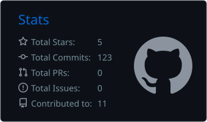
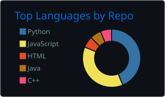
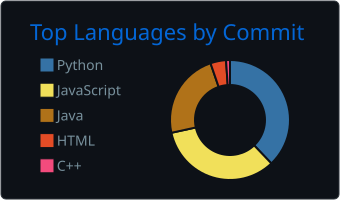

  

---

## 📊 GitHub Stats & Languages

  

## 📊 Development Stats

<table>
  <tr>
    <td align="center" width="50%">
      
    </td>
  </tr>
  <tr>
    <td align="center" width="50%">
      
    </td>
    <td align="center" width="50%">
      
    </td>
  </tr>
</table>

 

## ⚡ Recent Activity

<!--START_SECTION:activity-->
<!--END_SECTION:activity-->

## 🔗 Connect With Me

